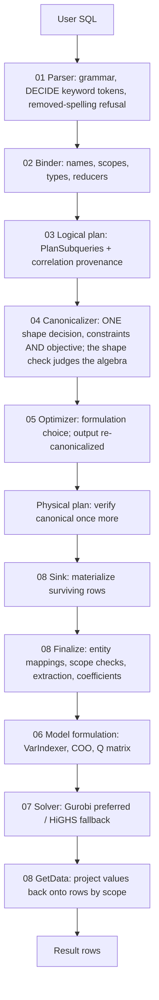

# System architecture

How DeciDB attaches to DuckDB, and the shape of the whole DECIDE path. For the
stage-by-stage detail see each stage's `done.md` (the stage table is in
[`../README.md`](../README.md));
for the file map see [`code_structure.md`](code_structure.md); for one query
walked end to end see [`trace_life_of_a_query.md`](trace_life_of_a_query.md).

---

## 1. Integration with DuckDB

DeciDB extends DuckDB's parser and planner to inject a new operator. It registers:

- **Reserved keywords** — `DECIDE`, `SUCH` (as in `SUCH THAT`), `MAXIMIZE`, `MINIMIZE`.
- **Gated tokens** — `WHEN_DECIDE`, `WHEN_DECIDE_OBJECTIVE`, `PER_DECIDE`,
  `PER_DECIDE_PAREN`, `PER_DECIDE_ROW` and `BY_DECIDE`, which the lexer emits only
  inside a DECIDE clause, so the clause's `when`, `per` and `by` never collide with
  SQL's `CASE ... WHEN`, a column named `per`, or `GROUP BY`.
- **Grammar productions** — `decide_clause`, `decide_declaration`, `decide_body`,
  `decide_tail`, `decide_constraint_item`, `decide_objective_item`, `decide_scope`,
  `decide_by`.
- **Transformer rules** — parsed nodes into `SelectNode` fields, the tagged scope,
  `by` and colon-form markers, and the refusal of the removed spellings
  (`RefuseRemovedDecideSpellings`).
- **A logical operator** — `LogicalDecide`, with hand-written serialization.
- **An optimizer pass** — `DecideOptimizer`.
- **A physical operator** — `PhysicalDecide`.

The design goal is to keep core DuckDB changes small and DeciDB's own code
cohesive. Standard SQL is unaffected: the DECIDE-specific tokens are gated, and every
grammar conflict DECIDE introduces is keyed on a DECIDE token.

### Edits to existing DuckDB code

Direct solve (`../direct_solve/`) replaces a DECIDE node with ordinary DuckDB operators, so its plans are only as cheap
as DuckDB's own rules and operators make them. Seven edits to DuckDB, none of which names DECIDE, make a plan the rules
build run as DuckDB would run the same answer written as SQL. Each helps any query that has the shape it handles, and a
standard query returns the same rows.

- **`CaseSimplificationRule` (`optimizer/rule/case_simplification.cpp`).** It evaluates a constant `WHEN` with
  `ExpressionExecutor::TryEvaluateScalar`. When the evaluation fails (an overflow, a bad cast) the check stays in the
  `CASE` and raises at run time, on the rows that reach it, as `ConstantFoldingRule` leaves an expression it cannot
  evaluate. Reason: the throwing `EvaluateScalar` would raise while planning, even over no rows and for a row an earlier
  `WHEN` takes, and the rewriter runs on direct plans, whose checks are `CASE`s that must raise only where they are
  chosen. The edit changes when an error is raised, not whether.
- **`StatisticsPropagator::PropagateExpression` for a `CASE` (`optimizer/statistics/expression/propagate_case.cpp`).**
  It propagates the `WHEN` checks first, then calls `CaseSimplificationRule::Simplify`, the fold the rule applies. A
  check the statistics prove false or NULL is erased. A check they prove true becomes the `ELSE` and ends the checks.
  When no check is left the `CASE` is its `ELSE`, and the expression is propagated again as that `ELSE`. A check that
  fails to evaluate stays and raises at run time, as in the rule. Reason: DuckDB folds a constant in the statistics
  handler that proves it (conjunction, comparison) and never reruns the expression rewriter after statistics, so a
  `CASE` whose check is proved only by statistics, such as `x IS NULL` over a NOT NULL column, would keep the check
  and evaluate it per row. A direct plan builds such checks for every nullable input, and its columns are often NOT
  NULL. `Simplify` is shared with the rule so the two folds cannot differ.
- **`ArithmeticSimplificationRule` (`optimizer/rule/arithmetic_simplification.cpp`).** For a FLOAT or DOUBLE expression
  it removes `x * 1.0`, `1.0 * x`, `x / 1.0` and `x - 0.0`. It matches `/` and the floating types
  (`IntegerOrFloatingTypeMatcher`, `matcher/type_matcher.hpp`) as well as the integer ones. Reason: these are the
  identities that hold bit for bit under IEEE 754 for every `x`, the sign of zero, NaN, the infinities and NULL
  included. `x + 0.0` is not one (`-0.0 + 0.0` is `+0.0`), nor is `x * 0.0` (`x` may be NaN or infinite), nor `x - -0.0`
  (it is `x + 0.0`), so those stay. DuckDB's rule set otherwise matches integer types only, and a direct plan computes
  in DOUBLE.
- **`StatisticsPropagator::PropagateStatistics` for a comparison join
  (`optimizer/statistics/operator/propagate_join.cpp`).** It changes a condition written IS NOT DISTINCT FROM to `=`
  when the statistics of neither side can hold a NULL. Reason: two keys that cannot be NULL are not distinct exactly
  when they are equal, and the perfect hash join takes only `=`.
- **`PerfectHashJoinExecutor` (`execution/operator/join/perfect_hash_join_executor.cpp`).** It takes the LEFT and SINGLE
  joins, the joins that keep every probe row, as well as the inner join, on one integer `=` condition. The build table
  has one slot past the build range, NULL in every column. A probe row whose key is NULL, outside the range or absent
  from the build reads that slot, and every probe row stays. A build side with duplicate keys still falls back to the
  hash join, so a SINGLE join's more-than-one-row error is still raised there. Reason: the class join of a direct plan
  is a SINGLE join on the class key. At `sf=1` it costs 20.8 ms of CPU as a SINGLE join on IS NOT DISTINCT FROM, 15.2 ms
  as a hash join on `=`, and 2.1 ms as a perfect hash join. Any LEFT join on a unique integer key of small range takes
  the same path.
- **`StatisticsPropagator::PropagateExpression` folds what it makes constant (`optimizer/statistics_propagator.cpp`).**
  After an expression's own handler, an expression whose children are all constants and which `IsFoldable` admits is
  evaluated with `ExpressionExecutor::TryEvaluateScalar` and becomes its value. An evaluation that fails leaves the
  expression, which raises at run time on the rows that reach it, as in `CaseSimplificationRule`. Reason: the handlers
  turn a child into a constant (a comparison or a `CASE` the statistics decide, a constant column below), and DuckDB
  never reruns the expression rewriter after statistics, so the expression above the new constant kept computing it per
  row.
- **Constant columns (`optimizer/statistics/expression/propagate_columnref.cpp`,
  `optimizer/statistics/operator/propagate_projection.cpp`).** A projection column whose expression is a constant, or a
  reference to such a column, is recorded with its value. A reference to it inside a computation (an argument of a
  function, a comparison, a `CASE`, a cast) becomes the constant before the computation is propagated, while the
  column's statistics agree with the value on NULL. A reference that is itself an output, a join key or a group stays a
  column, since a hash join and a hash aggregate are built on columns. Reason: a direct plan carries a constant through
  its stages as a column (a seed, a flag, a bound the query writes as a number), and the computation above reads it per
  row; the expression rewriter does not look through a projection.

Tests: `test/optimizer/statistics/statistics_case.test` (each fold, a nested `CASE`, a check that fails to evaluate),
`statistics_constant_folding.test` and `statistics_constant_columns.test` (the same directory),
`test/sql/optimizer/expression/test_case_simplification_error.test`, `test_nop_arithmetic_float.test` and
`test_not_distinct_from_to_equal.test`, `test/sql/join/left_outer/test_left_join_perfect_hash.test` (gaps, a NULL probe
key, a key out of range, duplicate build keys, an empty build), and `test/common/test_decidb_perfect_hash_join.cpp`
(which join types the executor takes).

---

## 2. Query lifecycle

Each stage is a folder with `done.md` (how it works) and, when work is open, `todo.md`. A change belongs to the
stage that owns the behavior, not the one that calls it first. Two things to read off the diagram:

- **Canonicalization sits between planning and optimization, not inside either.** The optimizer assumes canonical
  input and returns canonical output; it never decides shape. Every row it emits re-enters through `AddConstraint` /
  `SetObjective`, which re-canonicalize and re-verify, and `VerifyCanonical` runs once more at physical-plan entry.
- **Stages 06 and 07 run inside stage 08's `Finalize`.** They are separate stages because they own separate
  contracts (a solver-neutral model, and a backend translation), not because they run at separate times.

---

## 3. Four structural decisions

### The operator sits above the scan and the filter

`LogicalDecide` is inserted above the source scan and any `Filter`, so rows
eliminated by `WHERE` never become decision variables. For most queries this is
the single most impactful thing in the whole system — each surviving row is a
solver column.

A `Projection` sits above `LogicalDecide` and prunes auxiliary variable columns,
so the user's result contains only what they declared.

### Shape is decided exactly once

Which side of a comparison each term sits on, which way the relation points, and
where a factor on a reducer lives are decided by `DecideCanonicalizer`, on the
bound tree, before the optimizer runs. Every stage below consumes that shape and
none re-decides it; a verifier checks it at three points (in full in debug builds,
[`04_canonicalizer/done.md`](04_canonicalizer/done.md) §4).

That is stage 04's whole reason to exist as a stage;
[`04_canonicalizer/done.md`](04_canonicalizer/done.md) §1 explains why a pass that
may decline can never be a single home.

### A stage's promise is checked where it is read

Each stage leans on what an earlier one promises: the binder refuses a decision in a divisor, the shape check refuses
a degree above two, the canonicalizer writes each marker once. A reader that relies on such a promise checks it with
`throw InternalException("DECIDE: ...; <stage> promises ...")` (a precondition, in design-by-contract terms), so a
broken promise in a release build is an error that names the stage, not a wrong answer. `D_ASSERT`, compiled out of a
release build as in DuckDB, checks only what the same function established a few lines above. A query never reaches
these checks; each area's `done.md` names the ones it keeps.

### A message quotes the query by location

The parser keeps the DECIDE tail's text and one span per expression (`DecideSourceText`, Clang's SourceManager), and a
bound node names its span by its query location. A message cuts that text before it reprints anything. The location
rule follows Clang's TreeTransform: a replacement takes the location of exactly the node it equals in value
(`DecideReplaces`, one helper at each replacement site), and a node whose value differs from every node it replaces
takes none and prints its operator over quoted children. The invariant: an edit that changes a located node's value
must clear its location, or a message would quote text for a value the node no longer has. A macro expansion stands
where its call stood (Clang's expansion location). Per-stage detail is in
[`01_parser/done.md`](01_parser/done.md) §3 and [`03_logical_plan/done.md`](03_logical_plan/done.md) §6.

### Execution is stop-and-go

`PhysicalDecide` is a pipeline breaker. The optimal value of any one decision
depends on the entire dataset, so the operator must consume all of its input
before producing a row:

1. **Sink** — buffer every tuple into a `ColumnDataCollection`.
2. **Finalize** — build entity mappings, run the scope checks, evaluate every
   coefficient against that buffer — over each clause's kept rows (`when`), its
   classes (`per`) and its reducers' groups (`by`) — build the solver-neutral model,
   solve.
3. **Source** — re-scan the buffer and append solution values.

Read consistency follows: the optimization runs on the snapshot the query saw, and
concurrent modifications cannot affect a running solve.

---

## 4. What runs where

| Concern | Owner | Not owner |
|---|---|---|
| Syntax and expression association | Stage 01 | Anything that moves comparison terms |
| Names, scopes, types | Stage 02 | Anything that picks a formulation |
| Where terms sit, the spelling of a product, the algebra's validity and degree | Stage 04 | Every other stage |
| Formulation (Big-M, McCormick, easy/hard) | Stage 05 | The binder, the physical operator |
| Numeric values | Stage 08 | The canonicalizer, which never evaluates |
| Backend translation | Stage 07 | Anything that inspects a SQL plan |

Solver integration stays backend-agnostic: Gurobi and HiGHS must both remain valid
implementations, and a Gurobi-only API is an accelerator with a Big-M fallback,
never a dependency.
